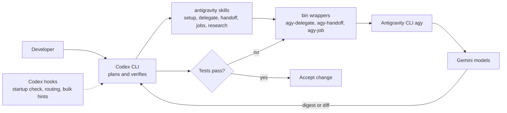
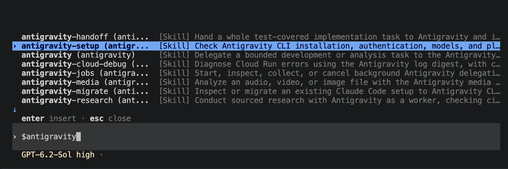

<div align="center">

# Antigravity for Codex CLI

Codex plans and verifies. The Antigravity CLI (`agy`) does the bounded work.

[](https://github.com/yuting0624/antigravity-for-claude-code/actions/workflows/ci.yml)
[](LICENSE)

</div>

## Overview

- **What it is:** a Codex CLI port of [antigravity-for-claude-code](https://github.com/yuting0624/antigravity-for-claude-code) by [linyuting](https://github.com/yuting0624) and contributors.
- **Maintainer:** [Paul Namalomba](https://github.com/paulnamalomba).
- **Status:** work in progress. See [Work in progress](#work-in-progress).
- **CI badge:** it reports the **upstream Claude project's** CI. This port has no badge of its own yet.
- **Origins:** [provenance](docs/codex/PROVENANCE.md) and [license](LICENSE).

## How it works



- Codex owns the plan and the final check. It never trusts `agy`'s own report that work passed.
- Skills and wrappers send a scoped task to `agy`, which runs it on Gemini.
- `agy` sends back a short digest or a diff instead of raw output, which keeps Codex's context small.
- Codex runs the tests itself. A failure goes back for one more attempt.

<div align="center">



</div>

## Install locally

### Prerequisites

- Codex CLI.
- The [Antigravity CLI](https://antigravity.google/docs/cli-using), signed in.
- Run `agy models` to see which models your account can use.

### Install

From a trusted checkout of this repository:

```bash
codex plugin marketplace add --json .
codex plugin add --json antigravity@antigravity-for-codex
```

- Marketplace file: [`.agents/plugins/marketplace.json`](.agents/plugins/marketplace.json).
- Skills tree: the plugin manifest points at [`codex/skills/`](codex/skills/).

<details>
<summary>Sample install output (Codex CLI 0.170.0 local test)</summary>

Registration returned `marketplaceName`, `installedRoot` and `alreadyAdded`. The install returned the fields below, with the temporary home path redacted:

```json
{
  "pluginId": "antigravity@antigravity-for-codex",
  "name": "antigravity",
  "marketplaceName": "antigravity-for-codex",
  "version": "0.31.2",
  "installedPath": "<temporary Codex home>/plugins/cache/antigravity-for-codex/antigravity/0.31.2",
  "authPolicy": "ON_INSTALL"
}
```

</details>

### After installing

- Start a new Codex session.
- Open `/hooks`, review the Antigravity hooks, and trust them so they run.
- After you edit the plugin, rerun `codex plugin add --json antigravity@antigravity-for-codex` to refresh the cache, then review any hook approvals that changed.

### Security notes

- Codex can copy a local Git checkout into its cache whole, `.git/config` included. Install only from a clean checkout you trust.
- To share a package, build it from a clean tracked export with no `.git` directory.
- Keep the [MIT license and copyright notices](LICENSE).

## Usage

### Skills

| Skill | Use it for |
| --- | --- |
| `antigravity:antigravity-setup` | Checking the install, sign-in, models and plugin |
| `antigravity:antigravity` | Handing off one bounded task |
| `antigravity:antigravity-handoff` | A whole task that has tests |
| `antigravity:antigravity-jobs` / `-status` | Background jobs |
| `antigravity:antigravity-research` | Research with sources |
| `antigravity:antigravity-review` | A second opinion on a diff |
| `antigravity:antigravity-media` | Audio, video and image files |
| `antigravity:antigravity-cloud-debug` | Cloud Run errors |
| `antigravity:antigravity-migrate` | Moving a Claude Code setup over |

- Wrapper flags, hooks, permissions and verification: [implementation notes](docs/codex/CODEX-PLUGIN-MIGRATION-IMPLEMENTATION.md).

### Hooks

- **Startup:** checks that `agy` is installed.
- **Startup and compaction:** adds routing guidance.
- **Prompt submit:** suggests delegation when a prompt looks like bulk work.
- **Tool guard:** applies to the optional `antigravity-delegate` role.

### Known limits

- In signed-in `agy 1.5.11` tests, one URL read returned `URL_READ_FAILED` and another timed out. URL access is unverified on the tested account.

### Measuring delegation

- Use the [Codex PoC playbook](docs/codex/POC-PLAYBOOK.md).
- The [upstream A/B results](docs/claude/AB-RESULTS.md) come from one Claude run per arm and leave out Gemini costs.

## Community project

- Not affiliated with or endorsed by Google, Anthropic or OpenAI.
- You are responsible for your own credentials, data-sharing choices and usage costs.
- Older Claude docs and measurements: [README.md.bak](README.md.bak) and [the Claude guides](docs/claude/).
- The port's research history: [original proposal and audit](docs/research/).
- Contributing to this port or to upstream: [CONTRIBUTING.md](CONTRIBUTING.md).

## Work in progress

- [ ] **npx package:** publish to npm so the plugin installs with one `npx` command, no clone needed.
- [ ] **Codex marketplace:** list the plugin on the public Codex plugin marketplace.
