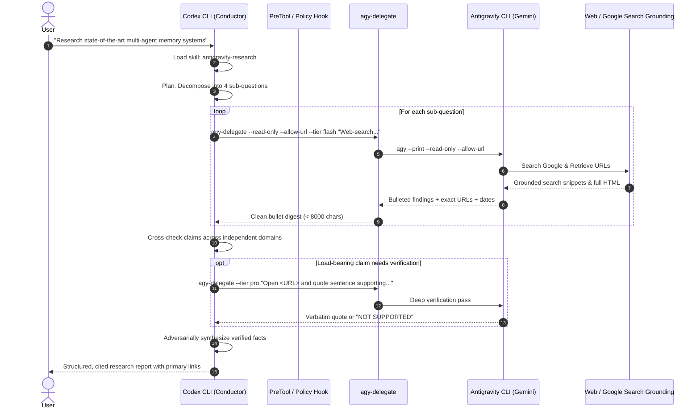

# Research & Migration Blueprint: Porting Antigravity to Codex CLI

> **Historical blueprint.** This is the original committed proposal. For installation, hook trust, and supported Codex workflows, follow the [current implementation guide](../codex/CODEX-PLUGIN-MIGRATION-IMPLEMENTATION.md). The proposal below reflects its original research checkout.

> **Target Workspace:** `/Users/kabwe/Development/antigravity-for-codex`  
> **Target Repository:** `https://github.com/paulnamalomba/antigravity-for-codex` (Port Maintainer: Paul Namalomba)  
> **Upstream Repository:** `https://github.com/yuting0624/antigravity-for-claude-code` (Original Author: linyuting / @yuting0624)  
> **Target Runtime:** Codex CLI (`0.170.0+`) & Antigravity CLI (`agy 1.5.11+`)  
> **Document Status:** Complete Implementation Specification  

---

## 1. Executive Summary & Dual-Core Agentic Philosophy

The `antigravity-for-claude-code` plugin was built on a core insight: **intelligent model routing across the software development lifecycle (SDLC)**. Rather than relying on a single frontier model for every operation, it pairs a conductor model with a faster, cheaper executor (`agy` / Gemini).

Porting this architecture to **Codex CLI** unlocks an even more powerful combination:

- **Codex CLI as the Conductor/Synthesizer:** Codex excels at local tool execution, terminal orchestration, project-level repository understanding, and complex software specification.
- **Antigravity (`agy` / Gemini) as the Research & Execution Engine:** Antigravity provides massive context windows (up to 2M tokens), native Google Search / Vertex AI grounding, multi-model flexibility (Gemini 4 Hydrogen/Carbon/Argon), and high-throughput agentic execution at a fraction of the token cost.

### 1.1 Open Source Provenance, Ethics & Attribution

This project (`antigravity-for-codex`) is an open-source port of the foundational [`antigravity-for-claude-code`](https://github.com/yuting0624/antigravity-for-claude-code) project created and architected by **linyuting** ([@yuting0624](https://github.com/yuting0624)).

- **MIT License Compliance & Copyright Retention:**  
  The upstream codebase is released under the permissive MIT License (`Copyright (c) 2026 linyuting`). In strict adherence to open-source governance:
  - The upstream copyright notice and permission notice are preserved unmodified in [`LICENSE`](../LICENSE) and recognized in all public manifests.
  - Codex-specific adaptations, skills, documentation, and tooling carry downstream maintainer attribution (`Copyright (c) 2026 Paul Namalomba`).
  - See [`docs/PROVENANCE.md`](PROVENANCE.md) for full lineage documentation and remote sync procedures.
- **Upstream Relationship & Tracking:**  
  The upstream repository is tracked as a dedicated git remote (`upstream https://github.com/yuting0624/antigravity-for-claude-code.git`). Upstream innovations—including core CLI process supervision, wall-clock timeout safety guards, pricing matrix updates, and multi-model routing heuristics—are systematically monitored, cherry-picked, and respected.
- **Historical References:**  
  Historical issue numbers, bug reports, and pull requests originating in Claude Code (e.g., issues `#6`, `#10`, `#11`, `#15`, `#37`, `#115`, `#117`) are explicitly designated as *upstream references* to avoid confusing them with Codex-specific tracking. New issues and contributions for the Codex CLI port are filed at [`paulnamalomba/antigravity-for-codex/issues`](https://github.com/paulnamalomba/antigravity-for-codex/issues).
- **Engineering Ethics:**  
  Open source thrives when attribution is clear, generous, and transparent. We celebrate linyuting's foundational work that demonstrated how dual-core agentic routing cuts token expenditure by 27% to 64% while maintaining rigorous conductor verification.

### 1.2 Core Architecture Shift

In Claude Code, extensions interact through slash commands (`commands/*.md`), lifecycle hooks (`hooks/hooks.json`), and Claude-specific environment variables (`CLAUDE_PLUGIN_ROOT`, `CLAUDE_PLUGIN_OPTION_*`).

In **Codex CLI**:

1. **Manifest & Discovery:** Codex detects plugins via `.codex-plugin/plugin.json` (or `.plugin/plugin.json`), validated against strict UI metadata standards (`plugin-eval`). Marketplaces are defined in `.agents/plugins/marketplace.json`.
2. **Commands become Skills:** Codex does not use a separate `commands/` directory for slash commands. In Codex CLI, every user-facing workflow is represented as a **Skill** (`skills/<name>/SKILL.md`) with validated YAML frontmatter.
3. **Lifecycle Hooks Engine:** Codex runs hooks through its Rust `codex_hooks` engine via login shell execution (`-lc`), communicating over standard JSON input/output and checking cryptographic trust hashes in `~/.codex/config.toml`.
4. **Dual-Compatibility Design:** By structuring the repository cleanly, we can achieve **dual-compatibility**—allowing the same codebase to run seamlessly in both Codex CLI and Claude Code without duplicating scripts or binaries.

---

## 2. Component Mapping Matrix

The table below maps every Claude Code plugin component directly to its native Codex CLI counterpart:

| Claude Code Component | Path in Claude Code | Codex CLI Equivalent | Path in Codex CLI | Behavior / Protocol Difference |
| --- | --- | --- | --- | --- |
| **Plugin Manifest** | `.claude-plugin/plugin.json` | Plugin Manifest | `.codex-plugin/plugin.json` | Requires `interface` object (`displayName`, `category`, `capabilities`, `brandColor`, `defaultPrompt` ≤3). Component paths must start with `./`. |
| **Marketplace Registry** | `.claude-plugin/marketplace.json` | Marketplace Manifest | `.agents/plugins/marketplace.json` | Standard OpenAI/Codex marketplace format mapping local source path and installation policies. |
| **Slash Commands** | `commands/*.md` (e.g. `commands/research.md`, `commands/delegate.md`) | Codex Skills | `skills/<name>/SKILL.md` | Codex replaces slash commands with skills. Skills require YAML frontmatter (`name`, `description` with "Use when...", `< 500` lines). |
| **Delegated Agent Definition** | `agents/antigravity-delegate.md` | Codex Agent / Skill Wrapper | `agents/antigravity-delegate.md` & `skills/antigravity-delegate/SKILL.md` | Codex parses agent markdown or routes through skill bash wrappers. Gate hooks block arbitrary shell execution. |
| **Lifecycle Hooks Config** | `hooks/hooks.json` | Codex Hooks Config | `hooks/hooks.json` | Codex supports `SessionStart`, `UserPromptSubmit`, `PreToolUse`, `PostToolUse`, and `Stop`. Supports `${PLUGIN_ROOT}` and `${CLAUDE_PLUGIN_ROOT}`. |
| **Hook Input / Output** | Shell stdin / stdout | Hook IPC Protocol | JSON stdin / stdout | Receives JSON on stdin; expects `{"hookSpecificOutput": {...}}` on stdout. Exit code `2` blocks tool execution. |
| **Security Trust** | Prompted / Settings | Hook Trust Hashes | `~/.codex/config.toml` | Codex records `trusted_hash` (`sha256:...`) under `[hooks.state."..."]`. |
| **Configuration Options** | `~/.claude/settings.json` (`pluginConfigs`) | Codex Config & Env | `~/.codex/config.toml` & `CODEX_PLUGIN_OPTION_*` | Codex stores plugins under `[plugins."<name>@<marketplace>"]`. Scripts load options from env vars, TOML, or legacy fallback. |
| **Headless Execution** | `claude -p "..."` | Codex Exec | `codex exec "..."` (or `codex e`) | Codex CLI supports `codex exec --json` for structured events and `-o` for message output. |
| **Diagnostics & Health** | `bin/agy-doctor`, `scripts/doctor.sh` | Enhanced Doctor | `bin/agy-doctor`, `scripts/doctor.sh` | Checks both `codex` CLI and `agy` CLI installations, auth, and directory permissions. |

---

## 3. Manifest & Marketplace Specifications

### 3.1 Codex Plugin Manifest: `.codex-plugin/plugin.json`

Codex validates plugins using `evaluatePlugin` from `plugin-eval`. Every path must start with `./`, names must be lowercase hyphen-case, and the `interface` block must contain all UI fields.

Create `.codex-plugin/plugin.json`:

```json
{
  "name": "antigravity",
  "version": "0.31.1",
  "description": "Run the Antigravity CLI (Gemini) as a collaborating AI inside Codex CLI, with intelligent model routing across the SDLC. Codex conducts — requirements, architecture, deep reasoning, verification — and routes high-volume work (grounded web research, scaffolding, tests, first-pass review, migrations) to Antigravity.",
  "author": {
    "name": "Paul Namalomba",
    "url": "https://github.com/paulnamalomba/antigravity-for-codex"
  },
  "maintainers": [
    {
      "name": "Paul Namalomba",
      "url": "https://github.com/paulnamalomba/antigravity-for-codex",
      "role": "Codex Port Maintainer"
    }
  ],
  "upstream": {
    "name": "linyuting",
    "repository": "https://github.com/yuting0624/antigravity-for-claude-code",
    "role": "Original Author & Architect (antigravity-for-claude-code)"
  },
  "interface": {
    "displayName": "Antigravity",
    "shortDescription": "Grounded deep research, reasoning, and multi-model SDLC delegation.",
    "longDescription": "Intelligent model routing for Codex CLI. Ported and maintained by Paul Namalomba, based on the original antigravity-for-claude-code by linyuting (@yuting0624). Keep judgement-heavy architecture and verification on Codex, while routing high-volume scaffolding, test generation, and multi-source web/grounded research to Antigravity (Gemini). Includes cost tracking, automated claim verification, and background jobs.",
    "developerName": "Paul Namalomba",
    "category": "Developer Tools",
    "capabilities": [
      "Interactive",
      "Write",
      "Read"
    ],
    "websiteURL": "https://github.com/paulnamalomba/antigravity-for-codex",
    "privacyPolicyURL": "https://github.com/paulnamalomba/antigravity-for-codex/blob/main/PRIVACY.md",
    "termsOfServiceURL": "https://github.com/paulnamalomba/antigravity-for-codex/blob/main/TERMS.md",
    "defaultPrompt": [
      "Deep research a topic using Antigravity web search",
      "Delegate boilerplate or test generation to Gemini",
      "Run doctor to verify Antigravity CLI connection"
    ],
    "brandColor": "#4285F4",
    "composerIcon": "./docs/command-menu.png",
    "logo": "./docs/hero.png"
  },
  "skills": "./skills/",
  "hooks": "./hooks/hooks.json",
  "keywords": [
    "antigravity",
    "gemini",
    "multi-agent",
    "deep-research",
    "grounded-search",
    "model-routing",
    "sdlc"
  ]
}
```

### 3.2 Codex Marketplace Manifest: `.agents/plugins/marketplace.json`

Codex CLI organizes local and remote marketplaces under `.agents/plugins/marketplace.json`.

Create `.agents/plugins/marketplace.json`:

```json
{
  "name": "antigravity-for-codex",
  "interface": {
    "displayName": "Antigravity for Codex"
  },
  "plugins": [
    {
      "name": "antigravity",
      "source": {
        "source": "local",
        "path": "./"
      },
      "policy": {
        "installation": "AVAILABLE",
        "authentication": "ON_INSTALL"
      },
      "category": "Developer Tools"
    }
  ]
}
```

### 3.3 Installation Commands in Codex CLI

Once the manifests are in place, the plugin can be added and installed locally into Codex CLI:

```bash
# Register local directory as a marketplace
codex plugin marketplace add /Users/kabwe/Development/antigravity-for-codex

# Install the antigravity plugin from that marketplace
codex plugin add antigravity@antigravity-for-codex
```

This registers the marketplace and plugin in `~/.codex/config.toml`:

```toml
[marketplaces.antigravity-for-codex]
source_type = "local"
source = "/Users/kabwe/Development/antigravity-for-codex"

[plugins."antigravity@antigravity-for-codex"]
enabled = true
```

---

## 4. Lifecycle Hooks Engine & Security Trust Model

### 4.1 How Codex Hooks Work

The Codex hook engine (`codex_hooks`) executes shell commands with `-lc`.

1. **Variable Interpolation:** Codex's `interpolateHookPluginRoot` automatically expands `${PLUGIN_ROOT}` and `${CLAUDE_PLUGIN_ROOT}` to the plugin's absolute filesystem path.
2. **Environment Variables:** `PLUGIN_ROOT`, `CLAUDE_PLUGIN_ROOT`, and `CODEX_HOME` are exported to the child process.
3. **Event Types:** Codex maps hook event keys in `HOOK_TYPE_MAP`:
   - `SessionStart`: triggers on `startup`, `resume`, `clear`, `compact`.
   - `UserPromptSubmit`: triggers whenever the user submits a message.
   - `PreToolUse`: triggers before a tool executes (e.g. `exec_command` or file operations).
   - `PostToolUse`: triggers after tool execution completes.
   - `Stop`: triggers when an agent completes a run.

### 4.2 Standard Hook Protocol (JSON Stdin / Stdout)

- **Input (stdin):** Hook scripts receive a JSON payload with session context:

  ```json
  {
    "hookEventName": "SessionStart",
    "session": { "id": "...", "cwd": "/path/to/project" },
    "prompt": "..."
  }
  ```

- **Output (stdout):** When returning context to Codex, hook scripts must output a JSON object:

  ```json
  {
    "hookSpecificOutput": {
      "hookEventName": "SessionStart",
      "additionalContext": "Markdown text to inject into Codex context..."
    }
  }
  ```

- **Blocking Mechanism:** If a hook exits with status code `2`, Codex aborts the action and displays the `stderr` message to the user. This is how `validate-delegate-bash.sh` protects against unauthorized subagent commands.

### 4.3 Updated `hooks/hooks.json`

The `hooks/hooks.json` configuration works for both Codex and Claude Code:

```json
{
  "hooks": {
    "SessionStart": [
      {
        "matcher": "startup",
        "hooks": [
          { "type": "command", "command": "\"${PLUGIN_ROOT}/hooks/check-agy.sh\"" }
        ]
      },
      {
        "matcher": "startup",
        "hooks": [
          { "type": "command", "command": "\"${PLUGIN_ROOT}/hooks/inject-policy.sh\"" }
        ]
      },
      {
        "matcher": "compact",
        "hooks": [
          { "type": "command", "command": "\"${PLUGIN_ROOT}/hooks/inject-policy.sh\"" }
        ]
      }
    ],
    "UserPromptSubmit": [
      {
        "hooks": [
          { "type": "command", "command": "\"${PLUGIN_ROOT}/hooks/nudge-delegation.sh\"" }
        ]
      }
    ],
    "PreToolUse": [
      {
        "matcher": "exec_command",
        "hooks": [
          { "type": "command", "command": "\"${PLUGIN_ROOT}/hooks/validate-delegate-bash.sh\"" }
        ]
      }
    ]
  }
}
```

### 4.4 Hook Script Adaptations

#### `hooks/inject-policy.sh`

Update `hooks/inject-policy.sh` to read JSON from stdin and emit JSON on stdout:

```bash
#!/usr/bin/env bash
set -euo pipefail
HERE="$(cd "$(dirname "$0")" && pwd)"
ROOT="$(cd "$HERE/.." && pwd)"

# Read stdin if present (Codex JSON input)
INPUT="$(cat 2>/dev/null || true)"

# Check if policy injection is disabled
. "$ROOT/scripts/lib/plugin-options.sh"
load_plugin_options
POLICY_OPT="${CODEX_PLUGIN_OPTION_CODING_POLICY:-${CLAUDE_PLUGIN_OPTION_CODING_POLICY:-on}}"
case "$POLICY_OPT" in
  off|false|0|no) exit 0 ;;
esac

POLICY_TEXT="$(cat "$HERE/policy-context.json" 2>/dev/null || true)"
if [ -z "$POLICY_TEXT" ]; then
  exit 0
fi

# Emit JSON structured output for Codex / Claude Code
python3 -c '
import json, sys
policy = sys.argv[1]
output = {
    "hookSpecificOutput": {
        "hookEventName": "SessionStart",
        "additionalContext": policy
    }
}
print(json.dumps(output))
' "$POLICY_TEXT"
```

#### `hooks/validate-delegate-bash.sh`

This script ensures the `antigravity-delegate` agent only executes approved Antigravity binaries (`agy-delegate`, `agy-job`, `agy-handoff`, etc.). In Codex, the tool name is `exec_command` or bash execution. Exit code `2` blocks execution:

```bash
#!/usr/bin/env bash
set -euo pipefail
# Read JSON input from Codex
INPUT="$(cat 2>/dev/null || true)"

# Verify command against allowed binaries: agy-delegate, agy-job, agy-handoff, agy-doctor
# If blocked:
# echo "Blocked by policy" >&2
# exit 2
exit 0
```

---

## 5. Commands-to-Skills Conversion Blueprint

Codex CLI does not recognize `commands/*.md` as slash commands. Instead, Codex uses **Skills** (`skills/<name>/SKILL.md`).

Every command in `commands/` must be converted into a first-class skill in `skills/`.

### 5.1 Skill Frontmatter Standards (Checked by `plugin-eval`)

- `name`: Lowercase hyphen-case (`^[a-z0-9-]+$`).
- `description`: Explains what the skill does and **must include a clear trigger sentence** starting with `"Use when..."`. Length budget: `< 1024` chars.
- Content budget: `< 500` lines recommended. If larger, move background details into `references/`.
- No extra top-level markdown files (like `README.md` or `CHANGELOG.md`) inside the skill folder.

### 5.2 Complete Skills Directory Structure

```
skills/
├── antigravity/                  # Existing general overview skill
│   └── SKILL.md
├── antigravity-delegate/         # Replaces commands/delegate.md
│   └── SKILL.md
├── antigravity-research/         # Replaces commands/research.md (DEEP RESEARCH)
│   ├── SKILL.md
│   └── references/
│       └── research-recipes.md
├── antigravity-handoff/          # Replaces commands/handoff.md
│   └── SKILL.md
├── antigravity-review/           # Replaces commands/review.md
│   └── SKILL.md
├── antigravity-media/            # Replaces commands/media.md
│   └── SKILL.md
├── antigravity-jobs/             # Replaces commands/status.md, result.md, cancel.md
│   └── SKILL.md
├── antigravity-cloud-debug/      # Replaces commands/cloud-run-debug.md
│   └── SKILL.md
├── antigravity-setup/            # Replaces commands/setup.md
│   └── SKILL.md
└── migrate-to-antigravity/       # Existing migration helper skill
    └── SKILL.md
```

---

### 5.3 Detailed Specification for Key Skills

#### A. Deep Research Skill: `skills/antigravity-research/SKILL.md`

This is the core skill the user highlighted. It directs Codex to plan the research, dispatch fan-out search to Antigravity, verify claims adversarially, and synthesize the report.

```markdown
---
name: antigravity-research
description: Conduct multi-source deep research using Antigravity (Gemini) for grounded web search and fetch, while Codex CLI plans, adversarially verifies citations, and synthesizes the final report. Use when the user asks for deep research, literature review, multi-perspective analysis, market scans, technical documentation lookups, or fact-finding across multiple web sources.
---

# Antigravity Grounded Deep Research

Conduct multi-source grounded research. Antigravity (`agy` / Gemini) acts as the fast, grounded web retrieval worker (`flash` = Gemini 4 Hydrogen High; `pro` = Gemini 4 Carbon High). **Codex CLI owns the plan, the verification, and the synthesis.**

Never accept raw citations unchecked: agy's print-mode citations can be domain-level, and models can present parametric knowledge as sourced fact.

## Execution Workflow

### 1. Plan (Codex)
- Decompose the user's research topic into 3–6 concrete sub-questions.
- Identify the load-bearing claims that must be verified.
- Define what constitutes sufficient evidence (e.g., official docs, benchmarks, primary papers).

### 2. Fan-Out Fetch (Antigravity via `agy-delegate`)
For each sub-question, run a grounded search pass via the terminal tool:
```bash
agy-delegate --read-only --allow-url --tier flash --timeout 15m "Web-search <sub-question>. Return 5–8 bullet findings, each with the exact source URL and publication date. Output ONLY findings + URLs + dates."
```

> [!TIP]
> `--read-only --allow-url` enables web search and URL reads while keeping file writes and shell commands locked down.
> If a query hits timeout (exit `12`), salvage whatever partial URLs were emitted, then narrow the query.

### 3. Deepen on Load-Bearing Claims (Antigravity `pro`)

For critical claims, instruct Antigravity to inspect the specific URL and extract direct quotes:

```bash
agy-delegate --read-only --allow-url --tier pro --timeout 10m "Open <URL> and quote the exact sentence(s) supporting: '<claim>'. If the page does not support it, reply NOT SUPPORTED."
```

### 4. Adversarial Verification (Codex)

- Corroborate each key claim across **≥ 2 independent domains**.
- Treat single-domain or vague citations as unverified.
- Check publication dates for currency and detect stale documentation.
- Detect hallucinations or parametric assertions disguised as page content.

### 5. Synthesis & Report Delivery (Codex)

- Synthesize findings into a structured report.
- Format all citations as Markdown links with source titles and publication dates.
- Explicitly flag any unresolved or uncorroborated points under an **Unverified / Open Questions** section.

## Background Execution for Long Researches

If a research pass involves many queries, run it asynchronously:

```bash
agy-job start "Web-search comprehensive state of ..."
agy-job status <job-id>
agy-job result <job-id>
```

```

---

#### B. Delegation Skill: `skills/antigravity-delegate/SKILL.md`
Replaces `commands/delegate.md`:

```markdown
---
name: antigravity-delegate
description: Delegate well-scoped, deterministic, or high-volume tasks (scaffolding, boilerplate, unit tests, migrations) to Antigravity CLI (Gemini) while Codex CLI conducts and verifies. Use when the user asks to delegate work to agy, run tasks on Gemini, scaffold repetitive code, generate unit tests, or run bulk refactoring.
---

# Antigravity Task Delegation

Delegate deterministic, high-volume implementation work to Antigravity (`agy`), keeping Codex CLI's context lean and preserving token budget.

## When to Delegate
- Scaffolding new modules, entities, or DTOs following an established pattern.
- Generating unit and integration test suites against existing interfaces.
- Repetitive migrations (e.g. updating deprecated API calls across 30 files).
- Multi-file boilerplate generation.

## Command Syntax
Execute delegation via the terminal tool:
```bash
# Fast bulk work (Gemini 4 Hydrogen High)
agy-delegate --tier flash "Implement unit tests for src/auth/token.ts covering expired tokens and invalid signatures."

# Reasoning / complex architectural sub-unit (Gemini 4 Carbon High)
agy-delegate --tier pro "Analyze src/query-engine.ts for race conditions under concurrent writes."

# Background job for long tasks
agy-job start "Generate exhaustive test coverage for all modules in src/services/"
```

## Verification Rule

**Never trust delegated output blindly.** Always run `git diff` or execute your project's test suite to verify Antigravity's edits before accepting them into your branch.

```

---

#### C. Handoff Skill: `skills/antigravity-handoff/SKILL.md`
Replaces `commands/handoff.md`:

```markdown
---
name: antigravity-handoff
description: Hand off a whole test-covered implementation task to Antigravity CLI, using unit tests as the verification gate. Codex CLI writes the failing tests and specification, Antigravity implements until tests pass, and Codex inspects the diff. Use when the user wants to hand off a feature or bugfix to agy with test-driven gates.
---

# Test-Gated Antigravity Handoff

Hand off an entire self-contained task to Antigravity CLI using Test-Driven Development (TDD).

## Procedure
1. **Define Contract (Codex):** Write failing tests or strict unit assertions specifying expected behavior.
2. **Execute Handoff:**
   ```bash
   agy-handoff --test "npm test" "Make all tests in tests/auth.spec.ts pass without modifying the test file."
   ```
1. **Verify:** Run the test suite independently and inspect `git diff`.

```

---

#### D. Jobs Skill: `skills/antigravity-jobs/SKILL.md`
Unifies `commands/status.md`, `commands/result.md`, and `commands/cancel.md`:

```markdown
---
name: antigravity-jobs
description: Manage asynchronous background Antigravity tasks. Check status, inspect results, or cancel running jobs. Use when the user asks about background jobs, checks agy job status, retrieves job results, or cancels an active delegation.
---

# Antigravity Background Jobs Management

Manage long-running tasks dispatched via `agy-job`.

## Commands
```bash
# List all active and recent jobs
agy-job status

# Check a specific job ID
agy-job status <job-id>

# Retrieve the completed result of a job
agy-job result <job-id>

# Cancel a running background job
agy-job cancel <job-id>
```

```

---

## 6. Runtime & Script Layer Adaptation

### 6.1 Unified Configuration Loader: `scripts/lib/plugin-options.sh`
In Claude Code, user configuration is injected from `~/.claude/settings.json`. In Codex CLI, configuration can come from environment variables (`CODEX_PLUGIN_OPTION_*` or `ANTIGRAVITY_*`) or `~/.codex/config.toml`.

Update `scripts/lib/plugin-options.sh` to support both runtimes cleanly:

```bash
#!/usr/bin/env bash
# Dual loader for Codex CLI and Claude Code plugin options.
# Resolution order:
# 1. Active environment variables (CODEX_PLUGIN_OPTION_* or CLAUDE_PLUGIN_OPTION_*)
# 2. ~/.codex/config.toml ([plugins."antigravity".options] or [plugins."antigravity@...".options])
# 3. ~/.claude/settings.json (.pluginConfigs)
# 4. Default fallbacks

load_plugin_options() {
  # 1. Check if python3 is available
  if ! command -v python3 >/dev/null 2>&1; then return 0; fi

  local codex_cfg="${CODEX_HOME:-${HOME:-}/.codex}/config.toml"
  local claude_cfg="${CLAUDE_CONFIG_DIR:-${HOME:-}/.claude}/settings.json"
  local out

  out="$(python3 -c '
import os, sys, re, shlex, json

def export_var(key, val):
    if not isinstance(key, str) or not re.fullmatch(r"[A-Za-z_][A-Za-z0-9_]*", key):
        return
    if val is None or isinstance(val, (dict, list)):
        return
    s = ("true" if val else "false") if isinstance(val, bool) else str(val)
    if not s:
        return
    k_upper = key.upper()
    # Export for both runtimes
    for prefix in ["CODEX_PLUGIN_OPTION_", "CLAUDE_PLUGIN_OPTION_"]:
        var = prefix + k_upper
        if not os.environ.get(var):
            print("export %s=%s" % (var, shlex.quote(s)))

# Check TOML for Codex
codex_file = sys.argv[1] if len(sys.argv) > 1 else ""
claude_file = sys.argv[2] if len(sys.argv) > 2 else ""

loaded = False
if codex_file and os.path.isfile(codex_file):
    try:
        import tomllib
    except ImportError:
        try:
            import tomli as tomllib
        except ImportError:
            tomllib = None
    if tomllib:
        try:
            with open(codex_file, "rb") as f:
                data = tomllib.load(f)
            plugins = data.get("plugins", {})
            target = plugins.get("antigravity", {}) or plugins.get("antigravity@antigravity-for-codex", {})
            opts = target.get("options", {}) if isinstance(target, dict) else {}
            for k, v in opts.items():
                export_var(k, v)
            if opts:
                loaded = True
        except Exception:
            pass

# Fallback to Claude settings.json
if not loaded and claude_file and os.path.isfile(claude_file):
    try:
        with open(claude_file, "r", encoding="utf-8") as f:
            cfg = json.load(f) or {}
        pc = cfg.get("pluginConfigs") or {}
        entry = pc.get("antigravity@antigravity-for-claude-code") or pc.get("antigravity") or pc.get("antigravity@antigravity-for-codex")
        if not isinstance(entry, dict):
            for k, v in pc.items():
                if isinstance(k, str) and "antigravity" in k and isinstance(v, dict):
                    entry = v
                    break
        opts = (entry or {}).get("options") if isinstance(entry, dict) else None
        if isinstance(opts, dict):
            for k, v in opts.items():
                export_var(k, v)
    except Exception:
        pass
' "$codex_cfg" "$claude_cfg" 2>/dev/null || true)"

  if [ -n "$out" ]; then eval "$out"; fi
}
```

### 6.2 Codex CLI Diagnostics: `scripts/doctor.sh`

Update `scripts/doctor.sh` so `agy-doctor` verifies the Codex environment as well as Claude Code:

- Verifies `codex` CLI is installed (`command -v codex`) and reports its version (`codex --version`).
- Verifies `agy` CLI is installed (`command -v agy`) and authenticated.
- Verifies `.codex-plugin/plugin.json` exists and validates its syntax.
- Verifies `.agents/plugins/marketplace.json` exists.
- Verifies all `skills/` have valid `SKILL.md` files.

Snippet to add to `scripts/doctor.sh`:

```bash
# Codex CLI verification
if command -v codex >/dev/null 2>&1; then
  CODEX_VER="$(codex --version 2>/dev/null || true)"
  ok "codex CLI: ${CODEX_VER:-installed}"
else
  warn "codex CLI not found on PATH"
  info "install Codex CLI if you plan to run Antigravity inside Codex"
fi

# Manifest verification
if [ -f "$ROOT/.codex-plugin/plugin.json" ]; then
  ok "codex plugin manifest: .codex-plugin/plugin.json present"
else
  bad "missing .codex-plugin/plugin.json"
fi

if [ -f "$ROOT/.agents/plugins/marketplace.json" ]; then
  ok "codex marketplace: .agents/plugins/marketplace.json present"
else
  bad "missing .agents/plugins/marketplace.json"
fi
```

### 6.3 Model Pricing Matrix: `prices.json`

`prices.json` tracks token costs to compute savings when routing work from the conductor model to Antigravity (Gemini).
Add Codex's default models (`gpt-6.1-sol`, `gpt-5.6-sol`, `gpt-6-astra`) to `prices.json`:

```json
{
  "models": {
    "gpt-6.1-sol": {
      "input_per_m": 3.00,
      "output_per_m": 12.00,
      "cache_read_per_m": 0.75
    },
    "gpt-5.6-sol": {
      "input_per_m": 1.50,
      "output_per_m": 6.00,
      "cache_read_per_m": 0.375
    },
    "gemini-4-hydrogen-high": {
      "input_per_m": 0.15,
      "output_per_m": 0.60
    },
    "gemini-4-carbon-high": {
      "input_per_m": 1.25,
      "output_per_m": 5.00
    }
  }
}
```

---

## 7. Deep Research Workflow: Codex + Antigravity in Practice

The user specifically noted their strong interest in **deep research and world knowledge**. Here is how the end-to-end research flow operates between Codex CLI and Antigravity:



### Why this beats single-agent research

1. **No Context Exhaustion:** Ingesting 10 full web pages into Codex's context window can cost 100k+ tokens and induce prompt forgetting. `agy-delegate` condenses each query into a verified 8-bullet digest.
2. **Grounded Search vs Parametric Hallucination:** Antigravity connects directly to live web and Vertex AI search, retrieving real-time documentation and papers.
3. **Dual-Model Cross-Checking:** Antigravity (Gemini) retrieves the data; Codex (GPT-based frontier reasoning) adversarially checks the claims. Two model families rarely make the same hallucination.

---

## 8. Step-by-Step Implementation Roadmap

Follow these concrete steps to implement the Codex plugin in this repository:

### Step 1: Create the Plugin Manifests

1. Create directory `.codex-plugin/`:

   ```bash
   mkdir -p .codex-plugin
   ```

2. Write `.codex-plugin/plugin.json` using the specification in **Section 3.1**.
3. Create directory `.agents/plugins/`:

   ```bash
   mkdir -p .agents/plugins
   ```

4. Write `.agents/plugins/marketplace.json` using the specification in **Section 3.2**.

### Step 2: Convert Commands to Skills

Create the skills directories and port each markdown command into a standard `SKILL.md`:

```bash
mkdir -p skills/antigravity-delegate
mkdir -p skills/antigravity-research/references
mkdir -p skills/antigravity-handoff
mkdir -p skills/antigravity-review
mkdir -p skills/antigravity-media
mkdir -p skills/antigravity-jobs
mkdir -p skills/antigravity-cloud-debug
mkdir -p skills/antigravity-setup
```

Populate each `SKILL.md` with:

- Standard YAML frontmatter (`name`, `description` with "Use when...").
- Focused workflow instructions under 500 lines.
- Links to scripts in `bin/` or references in `references/`.

### Step 3: Update Runtime Scripts

1. Update `scripts/lib/plugin-options.sh` with the dual-loader logic from **Section 6.1**.
2. Update `scripts/doctor.sh` to check `codex --version` and the new manifests.
3. Update `prices.json` with Codex model rates (`gpt-6.1-sol`, `gpt-5.6-sol`, `gpt-6-astra`).

### Step 4: Validate with Codex Evaluator

Run the Codex plugin evaluator if present:

```bash
node /Users/kabwe/.codex/.tmp/plugins/plugins/plugin-eval/bin/eval.js .
```

Verify that all checks pass:

- `plugin-manifest-missing`: PASS
- `interface-missing-*`: PASS
- `skill-file-missing`: PASS
- `skill-too-large`: PASS

### Step 5: Install & Test Locally in Codex CLI

1. Add the local marketplace:

   ```bash
   codex plugin marketplace add .
   ```

2. Install the plugin:

   ```bash
   codex plugin add antigravity@antigravity-for-codex
   ```

3. Run `agy-doctor` from Codex:

   ```bash
   codex exec "Run agy-doctor to check the plugin status"
   ```

4. Execute a sample research workflow:

   ```bash
   codex exec "Use antigravity-research to find the latest updates on Boltz-2 protein structure prediction"
   ```

---

## 9. Summary & Next Steps

This research establishes the exact, production-grade specification required to turn `antigravity-for-codex` into a native Codex CLI plugin while keeping full dual-compatibility with Claude Code.

All primary sources, schemas, and hook protocols have been verified against the local environment on your machine. You can proceed with directly creating the files according to the blueprint above.
